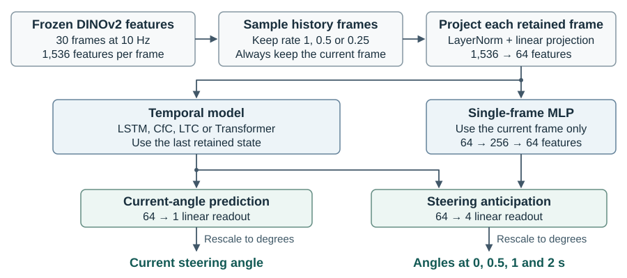

# Steering prediction with missing history frames

CSC413 project code for LSTM with elapsed-time input, CfC, LTC and a causal
Transformer. A single-frame MLP provides a no-history baseline. Inputs are
precomputed visual features and camera timestamps; outputs are steering-wheel
angles in degrees, for the current frame or at 0, 0.5, 1 and 2 seconds ahead.

The public interface consists of model definitions, a feature-cache reader,
one-run training and checkpoint inference. Users write their own experiment
drivers for learning-rate selection, repeated seeds and evaluation.

## Installation

Use Python 3.10 or newer. Install a PyTorch build for your platform, then:

```console
python -m pip install -r requirements.txt
```

Run the examples from this directory. The numerical reference for CfC and the
LTC cell both use `ncps==1.0.1`.

## Model architecture



Each model is trained separately for its task. Frame times come from the
original timestamps after history sampling. LSTM takes elapsed time as an
extra input, CfC uses it in its gate, and LTC integrates each interval in
24 substeps. The Transformer encodes time relative to the current frame.

### Trainable parameters

| Model | Model block | Input projection | Current-angle total | Anticipation total |
|---|---:|---:|---:|---:|
| LSTM | 33,536 | 98,368 | 131,969 | 132,164 |
| CfC | 33,024 | 98,368 | 131,457 | 131,652 |
| LTC | 33,216 | 98,368 | 131,649 | 131,844 |
| Transformer | 33,472 | 98,368 | 131,905 | 132,100 |
| Single-frame MLP | 33,088 | 98,368 | — | 131,716 |

Totals include the model block, input projection and linear readout. The
readout has 65 parameters for the current angle and 260 for anticipation.
The counts exclude the frozen DINOv2 encoder and LTC's 8,192 frozen mask
entries. The single-frame baseline was used only for anticipation.

## Train one model

Prepare the cache described in [docs/data.md](docs/data.md). Replace the paths
below with local paths to licensed data and an output directory.

```python
from data import FeatureCache
from training import TrainConfig, fit

cache = "/path/to/features"
train = FeatureCache(cache, "train", device="cpu")
val = FeatureCache(cache, "val", device="cpu")

checkpoint = fit(
    "lstm",  # lstm, cfc, ltc, transformer, or single_frame
    train,
    val,
    config=TrainConfig(lr=3e-4, seed=0),
    checkpoint_path="/path/to/outputs/lstm.pt",
)
print(checkpoint["best_epoch"], checkpoint["best_score"])
```

Use `device="cuda"` for both datasets to train on a CUDA device. For anticipation,
set `task="anticipation"` on both datasets; the same call then trains a four-output
readout. The temporal architecture is unchanged. Training uses mixed history
retention rates, standardised targets, AdamW and validation-based early stopping.
`fit` accepts only the train and validation splits. It saves the best model and
its normalisation/configuration; it does not save a resumable optimiser state.

## Infer from a checkpoint

```python
from inference import Predictor

predictor = Predictor("/path/to/outputs/lstm.pt", device="cpu")

# Supply actual feature windows and their original timestamps from your input pipeline.
# features: (batch, time, feature_dim), float; times: (batch, time), seconds.
angles = predictor.predict(features, times)
print(angles.shape)  # (batch,) for current angles, (batch, 4) for anticipation

# Optional controlled removal of history; the current frame is always retained.
sparse_angles = predictor.predict(features, times, keep=0.25, mask_seed=7)
```

Inference needs no steering labels, speed or data split. To predict a whole
prepared split, use `FeatureCache.batches()` in your own driver and keep the same
batch order as `FeatureCache.labels()` when scoring.

## Layout

- `models/cfc.py`: handwritten CfC cell and sequence wrapper.
- `models/steering.py`: shared projection/readout, temporal models and history masking.
- `data.py`: feature-cache loading and current/future target construction.
- `training.py`: train one configuration and select its best validation weights.
- `inference.py`: restore the model and return predictions in degrees.
- `metrics.py`: the macro MAE used for checkpoint selection.
- `docs/`: [input format](docs/data.md), [architectures](docs/models.md),
  [experiment settings](docs/experiments.md) and [reported results](docs/results.md).

## Verification

```console
python -m pip install -r requirements-dev.txt
python -m pytest -q
```

Tests use synthetic inputs. They check the CfC equations and reference outputs,
model parameter counts, causal attention, timestamp handling, labels, training
and checkpoint inference. No driving data or GPU is needed.

The Honda HDD videos, CAN records, feature caches, split manifest and trained
weights are not distributed here. Researchers must obtain dataset access and
prepare the documented inputs. The code consumes frozen features; image decoding,
feature extraction and statistical experiment orchestration are outside this
package. See [docs/experiments.md](docs/experiments.md) for the settings needed
to write a reproduction driver and the limits of exact reproduction.
